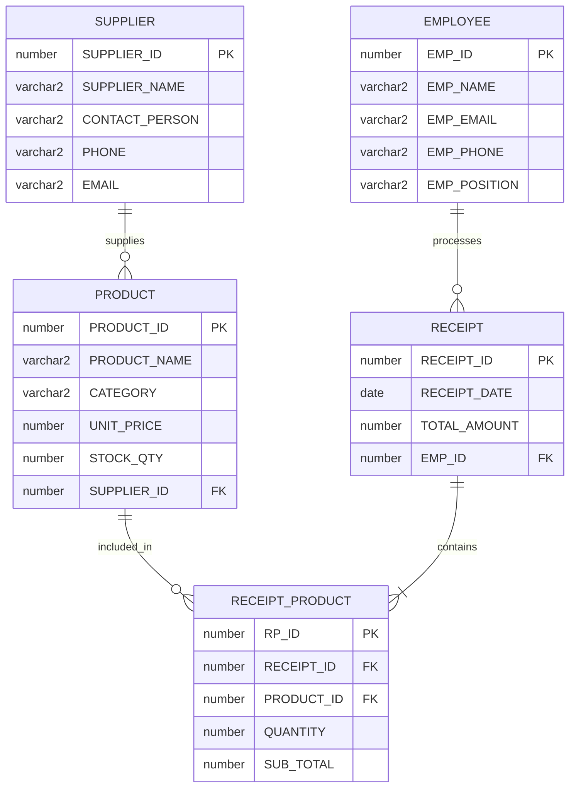

# 🖥️ CHAS — Computer Hardware Application System

[](https://www.php.net/)
[](https://www.oracle.com/database/)
[](https://getbootstrap.com/)
[](https://developer.mozilla.org/en-US/docs/Web/JavaScript)
[](https://github.com/akhmal02/Computer-Hardware-Sales)
[](LICENSE)

> **CHAS (Computer Hardware Application System)** is an internal enterprise management and business intelligence platform developed for **Pusat Komputer Pertama**. It centralizes hardware inventory management, supplier relations, employee administration, point-of-sale receipt issuance, and financial analytics into a unified web application backed by an **Oracle Enterprise Database**.

---

## 📌 Executive Summary & Purpose

Traditional retail computer hardware stores face critical hurdles in manual stock tracking, reconciling fragmented supplier purchase orders, tracking individual employee performance, and computing real-time sales profit margins. 

**CHAS** eliminates paper-based bottlenecks by providing:
* **Internal-Only Administrative Access:** A single secure portal engineered exclusively for authorized management and branch administrators—no external public/customer accounts.
* **Automated Stock & Inventory Control:** Real-time tracking of hardware stock, category grouping (CPUs, GPUs, Motherboards, RAM, Storage, Peripherals), and automated reorder alerts.
* **Point-of-Sale (POS) & Receipt Engine:** Immediate receipt generation, itemized order logging, and calculation of gross sales with auto-incremented Oracle database sequences.
* **Comprehensive Supplier Directory:** Maintenance of both domestic and international vendor pipelines with direct product association.
* **Business Intelligence & Reporting:** Managerial charts showing daily revenue velocity, top-selling inventory, and performance logs across operating quarters.

---

## 🔐 Access Control & Authentication

CHAS is designed strictly as an **Internal Enterprise Management System**:
* **User Accounts:** There is **no public registration or external customer account portal**. Customers do not log into the system; customer sales are recorded directly by administrators at checkout.
* **Administrative Gateway:** All functionality is protected behind a frosted-glass administrative sign-in portal.

### 🔑 Default Administrative Credentials
| Role | Username | Password | Purpose |
|---|---|---|---|
| **System Administrator** | `chasadmin` | `gulugulu` | Full administrative access to inventory, employees, receipts, suppliers, and analytics |

---

## 🚀 Key Modules & System Features

### 1. 📊 Executive Dashboard & Real-Time Metrics
* Live KPI summary cards powered by asynchronous JSON endpoints (`php/summary_data.php`).
* Immediate visibility into total cataloged hardware, active supplier contacts, gross accumulated sales, and pending stock counts.

### 2. 📦 Product & Hardware Inventory Management (`product/`)
* **Full CRUD Operations:** Add new hardware items, update pricing and specifications, and decommission discontinued parts.
* **Category Tagging:** Granular classification across PC components, pre-built desktop towers, laptops, and networking accessories.
* **Supplier Linking:** Direct foreign-key relationship tying every product to its primary hardware vendor.

### 3. 🚚 Supplier Network Management (`supplier/`)
* **Vendor Profiles:** Complete registry containing company names, representative points of contact, business emails, and physical headquarters.
* **Supply Chain Tracking:** Rapid lookup of vendor catalogs to verify part availability and procurement lead times.

### 4. 🧾 Point of Sale (POS) & Receipt Issuance (`receipt/`)
* **Interactive Checkout:** Cashiering module allowing selection of items, automatic line-item subtotal calculation, and instant grand total tallying.
* **Audit-Proof Receipts:** Generates unique, sequence-backed receipt records with itemized transaction details (`RECEIPT` and `RECEIPT_PRODUCT`).

### 5. 👥 Employee & Workforce Administration (`employee/`)
* Centralized employee ledger storing staff identification, designations, contact credentials, and operational assignments.
* Restricts access to sensitive operational reports to authorized store personnel.

### 6. 📈 Business Intelligence & Analytical Reports (`performance.php` & `report.php`)
* **Daily Sales Trajectory:** Visual charts illustrating turnover trends over chronological date ranges (`php/daily_sales_data.php`).
* **Category Breakdown:** Proportional analysis of sales volume across hardware segments (`php/category_purchase_data.php`).
* **Top-Performing Hardware:** Identifies bestselling parts to guide restocking priority (`php/top_product_data.php`).

---

## 🗄️ Database Architecture (Oracle Database)

CHAS utilizes the **Oracle Database Engine** via the PHP `oci8` extension. The database uses explicit Oracle sequences and constraints to ensure relational integrity:



### Oracle Sequences Implemented:
* `EMPLOYEE_SEQ` — Auto-generates unique IDs for employee records.
* `PRODUCT_SEQ` — Manages auto-incrementing serials for new hardware additions.
* `SUPPLIER_SEQ` — Assigns sequential identifiers for registered suppliers.
* `RECEIPT_SEQ` — Produces standardized invoice/receipt serials.
* `RECEIPT_PRODUCT_SEQ` — Tracks line items within individual transactions.

---

## 📂 Project Directory Structure

```text
Computer-Hardware-Sales/
├── CHAS DB.sql                  # Complete Oracle SQL schema, sequences & sample seed data
├── README.md                    # System documentation and setup guide
├── .gitignore                   # Excludes temp files and local credentials
└── chas/                        # Application source root
    ├── connect.php              # Active Oracle OCI database connection
    ├── connect.example.php      # Configuration template with placeholder credentials
    ├── dashboard.php            # Administrative control center & live KPI overview
    ├── login_auth.php           # Secure administrative sign-in portal
    ├── logout.php               # Session termination handler
    ├── performance.php          # Visual sales charts & BI performance analytics
    ├── report.php               # Formal printable managerial reports
    ├── assets/                  # CSS stylesheets, glassmorphic UI backgrounds & icons
    ├── employee/                # Employee management CRUD (add, view, update, delete)
    ├── product/                 # Hardware catalog CRUD (add, view, update, delete)
    ├── supplier/                # Vendor management CRUD (add, view, update, delete)
    ├── receipt/                 # POS checkout, receipt generator & transaction viewer
    └── php/                     # Asynchronous JSON API endpoints for AJAX charts
        ├── category_purchase_data.php
        ├── daily_sales_data.php
        ├── summary_data.php
        └── top_product_data.php
```

---

## 🛠️ Installation & Setup Guide

### 1. Prerequisites
* **Web Server:** [XAMPP](https://www.apachefriends.org/) (Apache + PHP 7.4 or 8.x).
* **Database Server:** [Oracle Database 19c](https://www.oracle.com/database/technologies/oracle19c-windows-downloads.html) or [Oracle Database Express Edition (XE)](https://www.oracle.com/database/technologies/appdev/xe.html).
* **PHP Extension:** Enable `extension=oci8_19` (or relevant OCI8 version) in your `php.ini` file.
* **Oracle Client:** Ensure [Oracle Instant Client](https://www.oracle.com/database/technologies/instant-client/downloads.html) is installed and configured in your system `PATH`.

### 2. Database Initialization
1. Open **Oracle SQL Developer** or **SQL*Plus**.
2. Connect to your Oracle database instance (e.g., as `SYSTEM` or your designated schema user).
3. Open and execute the complete script [`CHAS DB.sql`](CHAS%20DB.sql).
4. Verify that tables, sequences (`EMPLOYEE_SEQ`, `PRODUCT_SEQ`, etc.), and initial seed data have been successfully created.

### 3. Application Deployment
1. Clone or copy the repository into your web server's root directory:
   ```bash
   git clone https://github.com/akhmal02/Computer-Hardware-Sales.git C:/xampp/htdocs/chas
   ```
2. Configure your Oracle connection credentials by copying `connect.example.php`:
   ```bash
   cp chas/connect.example.php chas/connect.php
   ```
3. Open `chas/connect.php` in a code editor and enter your local Oracle connection details:
   ```php
   $user = "SYSTEM";               // Your Oracle schema user
   $pass = "your_oracle_password"; // Your Oracle password
   $host = "localhost/XEPDB1";     // Your Oracle Host and Service Name
   ```

### 4. Running the System
1. Start the **Apache** server from the XAMPP Control Panel.
2. Launch your web browser and navigate to:
   ```text
   http://localhost/chas/chas/login_auth.php
   ```
3. Sign in with the default admin credentials:
   * **Username:** `chasadmin`
   * **Password:** `gulugulu`

---

## 👨‍💻 Author & Academic Attribution
* **Developer:** Muhammad Akhmal bin Mohamad Hussin ([@akhmal02](https://github.com/akhmal02))
* **Institution:** Universiti Teknologi MARA (UiTM)
* **Faculty:** College of Computing, Informatics and Mathematics
* **Course:** Database Engineering / Application Development (ICT502)
